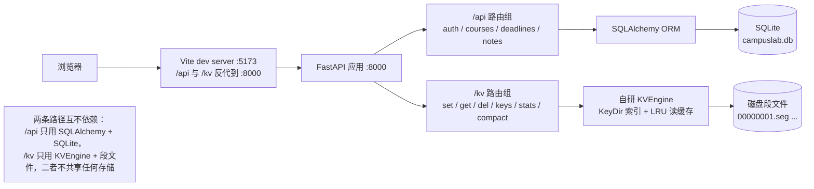

# CampusLab

CampusLab 是一个本地运行的校园学习平台：一个 FastAPI 后端、一个 React 前端，外加一个用来放作品和笔记的 Astro 个人站。后端管课程表、DDL 和笔记的增删改查，另外自带一套自己写的 Bitcask 风格 KV 存储引擎；前端除了这几个业务页面，还有两个把算法过程回放成动画的可视化页；个人站是独立的静态站点，和前面两个不共用代码，它上面的排序可视化是从 frontend 复制并适配过来的，两边各自持有一份文件。

**在线预览**：[个人站](https://caspase-sheng.github.io/CampusLab/) · [排序可视化演示](https://caspase-sheng.github.io/CampusLab/lab/)

## 仓库结构

- `backend/`：FastAPI 应用。`app/api/` 是业务接口（auth / courses / deadlines / notes），`app/kv/` 是一套独立的 KV 存储引擎（带 `/kv` 路由），`app/models/`、`app/schemas/`、`app/db/` 是 SQLAlchemy 模型、Pydantic 模型和会话，`alembic/` 放迁移，`tests/` 放 pytest 用例，`scripts/bench_kv.py` 是个独立的存储性能对比脚本。
- `frontend/`：React 19 + Vite 单页应用。`src/pages/` 是页面（登录、注册、仪表盘、课程、DDL、笔记、两个可视化），`src/api/` 是接口封装，`src/auth/` 是登录态，`src/lib/` 放前端内置的排序和图算法，`src/utils/` 放时间格式化这类小工具。
- `personal-site/`：Astro 静态作品站。`src/content/` 下的 `projects/`、`blog/`、`notes/` 分别是项目介绍、博客和笔记，`src/site.config.ts` 集中放站点文案和链接，`src/pages/` 按内容类型生成列表与详情页。除了这些内容页，还有一个 `/lab` 页面放交互演示（目前是排序可视化）。
- `docs/`：只有一份 `CONTRACT.md`，是前后端约定的接口契约（路由、请求响应结构、错误码、时间与鉴权约定、数据库表）。实现按它来，已知偏差见文末「已知限制」。

## 技术栈

- 后端：Python + FastAPI 0.115 + SQLAlchemy 2.0 + SQLite + Alembic；鉴权用 python-jose 签发 HS256 JWT、passlib + bcrypt 做密码哈希；测试用 pytest + httpx。
- 前端：React 19 + TypeScript + Vite + Tailwind 4，路由用 react-router。
- 个人站：Astro 5，内容用 Astro 的内容集合（content collections）管理，纯静态输出。

## 架构图



图里 `/api` 和 `/kv` 是两条独立的链路，中间没有任何依赖：业务数据一律走 SQLAlchemy 落到 SQLite，KV 引擎只在自己的段文件上读写，业务代码从不调用它。开发期的前端只用到 `/api`，`/kv` 目前独立暴露，前端还没用到它。

## 怎么跑起来

后端和前端都必须在各自的子目录下启动，不能从仓库根目录带路径运行——`DATABASE_URL`（`sqlite:///./campuslab.db`）和 `KV_DATA_DIR`（`data/kv`）都是相对路径，换个工作目录就会在别的地方建库、建段文件。

### backend

```powershell
cd backend
python -m venv .venv
.\.venv\Scripts\Activate.ps1
pip install -r requirements.txt
copy .env.example .env        # 然后编辑 .env，把 SECRET_KEY 换成自己的值
alembic upgrade head          # 建表，这一步不能省
uvicorn app.main:app --reload --port 8000
```

跑测试：

```powershell
cd backend
.\.venv\Scripts\python.exe -m pytest tests/ -q
```

### frontend

```powershell
cd frontend
npm install
npm run dev
```

dev server 在 5173 端口，`/api` 和 `/kv` 会被代理到本地的 8000，所以后端要同时起着。

### personal-site

```powershell
cd personal-site
npm install
npm run dev
```

产出静态站点用 `npm run build`，本地预览构建产物用 `npm run preview`。

### 一键启动（可选）

在仓库根执行 `.\dev.bat`：先检查三个子目录的依赖和 `backend\.env`，缺依赖只提示、不自动装；然后跑 `alembic upgrade head`，最后开三个新窗口分别起后端、前端和个人站。只想验证环境、不开窗口、也不跑迁移，用 `.\dev.bat -CheckOnly`。若报「禁止运行脚本」，先执行 `Set-ExecutionPolicy -Scope CurrentUser RemoteSigned`，或改用 `powershell -ExecutionPolicy Bypass -File .\dev.ps1`。

## 测试

后端 pytest 当前 117 个用例，全部通过。覆盖 auth、courses、deadlines、notes 四组接口的行为（包括越权访问和参数校验）、模型的级联删除与唯一约束，以及 KV 引擎的段文件编解码、LRU 缓存、引擎读写与崩溃恢复、`/kv` 路由。

前端用 `npm test` 跑（Node 内置的 `node:test`，不装任何依赖），覆盖 `src/lib/` 下排序与图算法两个纯函数模块。个人站仍然没有自动化测试，改动靠手动在 dev server 上点；要注意个人站那份 `src/lib/sorting.ts` 是从 frontend 复制的，没有测试覆盖，改它不会触发任何断言，两边需要手动保持同步。

## 已知限制

- KV 引擎只支持单进程：一把进程内的可重入锁把段文件 I/O 和 KeyDir 串行化，不支持多进程共享同一个数据目录。
- KV 写入只调 `file.flush()`，不调 `fsync`，整机掉电时可能丢掉最后几条刚写的记录。
- JWT 黑名单还没实现：契约里写了「黑名单存 KV」，但项目没有 logout 接口，现在退出登录只是清掉本地 token，服务端签发的 token 在过期前仍然有效。
- 笔记页不渲染 Markdown：正文按纯文本编辑、按纯文本显示，预览功能还没做。
- 课程周视图不做同格避让，同一时段同一天的课会叠在一起；`week_range` 只在表单里编辑、在卡片上展示，不参与渲染计算，因为项目里没有「当前第几周」这个概念。
- 前后端目前只在本地跑，还没做部署。

## 关于

课程 / 个人项目，代码可参考。
